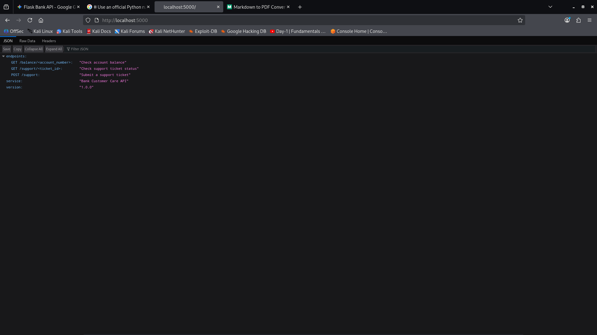
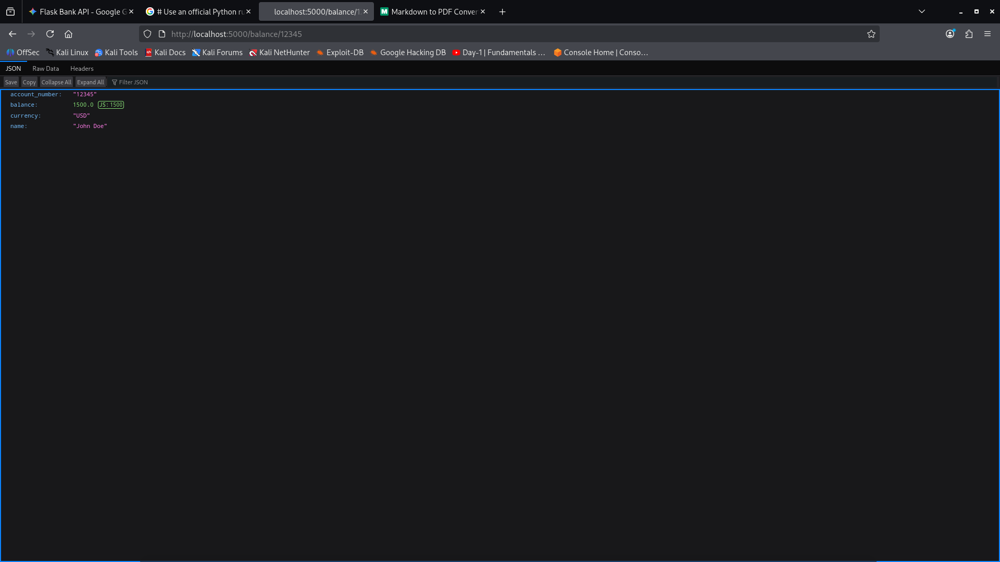

# Bank Customer Care Service API

A simple, containerized Flask app built to handle basic banking customer care workflows—checking account balances and opening or tracking support tickets.

I put this together to practice containerizing a Python backend with Docker, keeping things lightweight using a slim base image and managing the container lifecycle locally.

---

## What it does

* **Check Balances:** Look up mock customer account info.
* **Submit Tickets:** Send in a support issue and get back a unique ticket ID (like `TICK-85569`).
* **Track Status:** Check on open tickets using their ID.




---

## Tech Stack

* **Python 3.11** (running on `python:3.11-slim`)
* **Flask**
* **Docker**

---

## Endpoints

| Method | Route | What it does |
| --- | --- | --- |
| `GET` | `/` | Home page (lists available endpoints) |
| `GET` | `/balance/<account_number>` | Get account holder name and balance |
| `POST` | `/support` | Create a support ticket (`account_number`, `issue`) |
| `GET` | `/support/<ticket_id>` | Check a ticket's current status |

---

## How to Run It Locally

### 1. Build the Docker Image

Make sure you're in the project directory where your `Dockerfile`, `requirements.txt`, and `app.py` live, then run:

```bash
docker build -t customer-care-service-app .

```

### 2. Run the Container

Spin it up and map port `5000`:

```bash
docker run -d -p 5000:5000 --name customer-care-app-container customer-care-service-app

```

---

## Testing It Out

**Check an account balance:**

```bash
curl http://localhost:5000/balance/12345

```

**Submit a support ticket:**

```bash
curl -X POST http://localhost:5000/support \
  -H "Content-Type: application/json" \
  -d '{"account_number": "12345", "issue": "App login error"}'

```

**Check the ticket status:** *(replace with the ID returned from your POST request)*

```bash
curl http://localhost:5000/support/TICK-85569

```

